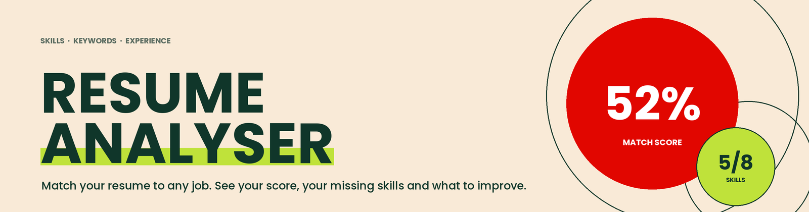
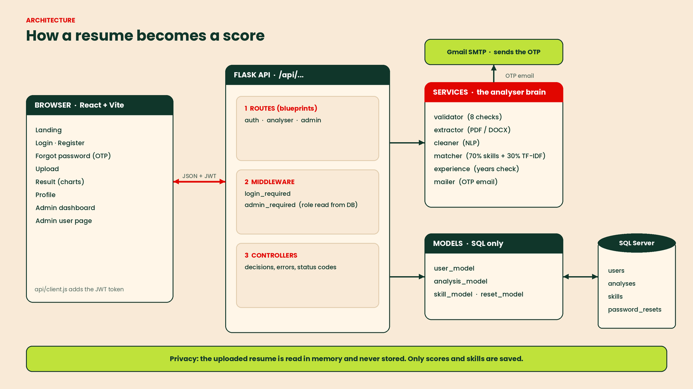
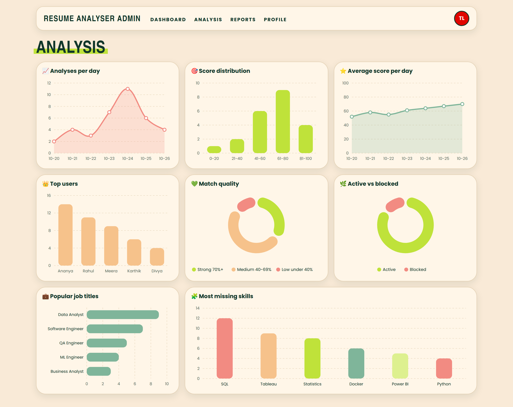

# Resume Analyser

A web app that compares a resume with a job description and shows a match
score, matched skills, missing skills and suggestions.

## Tech's involved
- Backend: Python, Flask, pyodbc (SQL Server)
- Frontend: React (Vite)
- Analysis: pdfplumber, scikit-learn (TF-IDF, cosine similarity)

## Features
- Register and login with JWT, role-based access (user and admin)
- Upload a resume (PDF or DOCX) and a job description
- Validation: file type, real file content, size, scanned PDFs, non-resume detection
- Match score: skill match (70%) + TF-IDF cosine similarity (30%)
- Matched and missing skills, suggestions, page-length rule, experience check
- Charts: doughnut, bar, line
- Admin dashboard: stats, users (block and delete), per-user activity, analyses
- Privacy: resumes are processed in memory and never stored

## Architecture

## Setup (backend)
1. `cd backend`
2. `python -m venv venv` then activate it
3. `pip install -r requirements.txt`
4. Copy `.env.example` to `.env` and fill in your values
5. Create the database and tables in SQL Server (`db/schema.sql`)
6. `python app.py`

## Run
from main project folder resume-analyser npm run dev

## Admin Analysis

